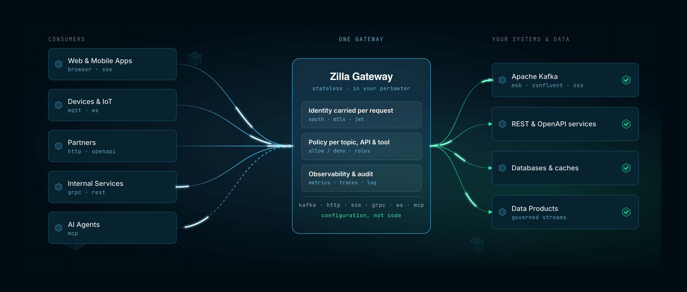
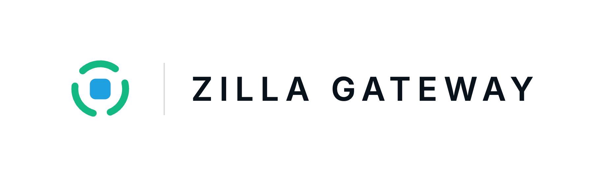
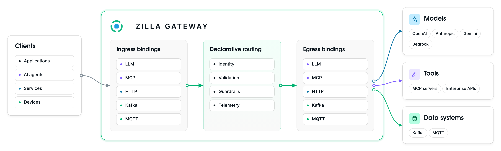

<div id="top"></div>

<div align="center">
  
  <!--  --> 
  
  <picture>
    <!-- Source for dark mode -->
    <source media="(prefers-color-scheme: dark)" srcset="./assets/zilla-gateway-lockup-dark.png">
    <source media="(prefers-color-scheme: light)" srcset="./assets/zilla-gateway-lockup-light.png">
    <!-- Fallback image for light mode and other clients -->
    
  </picture> 
  
</div>


<div align="center"> 
  
  <!--[![Build Status][build-status-image]][build-status]-->
  [![Latest Release][release-latest-image]][release-latest]
  [![Slack Community][community-image]][community-join]
  [![Artifact HUB][artifact-hub-shield]][artifact-hub]
  
</div>

<div align="center">
  <a href="https://docs.aklivity.io/latest/">Docs</a> &bull;
  <a href="https://docs.aklivity.io/latest/ai-gateway/get-started/">Quickstart</a> &bull;
  <a href="/examples">Examples</a> &bull;
  <a href="https://github.com/aklivity/zilla-demos">Demos</a> &bull;
  <a href="https://www.aklivity.io/blog">Blog</a>  
</div>

<br></br>
> 
> Before moving on, please consider giving us a GitHub star ⭐️. Thank you!
> 

* * * * *

**Zilla is a streaming-native, multi-protocol gateway for AI, APIs, and real-time data.**

Connect applications to LLMs, give AI agents governed access to enterprise tools, and expose Kafka streams through application-friendly protocols. Zilla provides protocol translation, routing, security, and observability in a lightweight, stateless runtime, configured declaratively in `zilla.yaml`.

**One engine, many use cases.** LLM access, MCP tool connectivity, and event streaming are different routes through the same gateway, not separate proxy products to deploy and operate.

## Contents

- [What You Can Build](#what-you-can-build)
- [Why One Multi-Protocol Gateway?](#why-one-multi-protocol-gateway)
- [Get Started](#get-started)
- [How Zilla Works](#how-zilla-works)
- [Governance in the Data Path](#governance-in-the-data-path)
- [Streaming-Native by Design](#streaming-native-by-design)
- [Capabilities at a Glance](#capabilities-at-a-glance)
- [Zilla Plus and Zilla Console](#zilla-plus-and-zilla-console)
- [Install and Deploy](#install-and-deploy)
- [Documentation and Examples](#documentation-and-examples)
- [Community and Contributing](#community-and-contributing)
- [License](#license)

## What You Can Build

### ⚡ Connect and govern real-time data

Expose Kafka through REST, SSE, WebSocket, gRPC, and MQTT without building custom protocol bridges. Validate schemas, control access, and connect browsers, services, and devices to event streams. With **Zilla Plus**, transparently proxy native Kafka clients and Kafka Connect, including across network boundaries.

**Explore:** [Kafka Gateway](https://docs.aklivity.io/latest/kafka-gateway/) · [Kafka use cases](https://docs.aklivity.io/latest/kafka-gateway/use-cases/) · [REST example](./examples/http.kafka.crud/)

### ✨ Connect applications to LLMs

Keep using supported OpenAI, Anthropic, and Gemini SDKs while Zilla routes requests to the right model provider. Translate supported chat and tool-call workflows across APIs, stream responses, apply configurable guardrails, and observe token usage and latency. Configure fallback for unreachable model deployments.

**Explore:** [LLM Gateway](https://docs.aklivity.io/latest/ai-gateway/llm-gateway/) · [Cross-provider demo](https://github.com/aklivity/zilla-demos/tree/main/llm.gateway)

### 🤖 Give AI agents governed access to tools and data

Present one MCP endpoint for existing MCP servers, HTTP/OpenAPI services, and Kafka. Expose Kafka topics, Kafka Connect, and Schema Registry operations as MCP tools without custom wrapper services. Authorize what each caller can discover and invoke, and keep large tool catalogs manageable with eager and on-demand discovery.

**Explore:** [MCP Gateway](https://docs.aklivity.io/latest/ai-gateway/mcp-gateway/) · [MCP example](./examples/mcp.proxy/)

## Why One Multi-Protocol Gateway?

Kafka and AI solve different problems. Kafka moves real-time data, LLM APIs connect applications to models, and MCP connects agents to tools. But the infrastructure needed to connect them has much in common: **routing, identity, access control, protocol mediation, policy enforcement, and observability**.

Zilla was built as a streaming-native, multi-protocol engine rather than a collection of standalone proxies. Protocol-aware bindings connect clients and backends, while routing, security, telemetry, and declarative configuration are managed through the same runtime. Each protocol retains its own semantics and specialized controls.

That architecture matters both when these workloads are separate and when they intersect. Use Zilla to govern LLM access without Kafka, to expose Kafka without AI, or to connect them directly—for example, letting an agent discover and invoke Kafka-backed tools through MCP without building a custom integration service.

**Use either capability on its own. Combine them when your applications need both.**

## Get Started

Run Zilla locally with Docker Compose and expose a Kafka topic as a REST API. The example starts Zilla, Kafka, and Kafka UI; no external service credentials are required.

**Prerequisite:** Docker with Docker Compose.

```bash
git clone --depth 1 --branch 2.6.0 https://github.com/aklivity/zilla.git
cd zilla/examples/http.kafka.crud
docker compose up --wait
```

Produce a record over HTTP, then retrieve it by key:

```bash
curl -i -X POST http://localhost:7114/items \
  -H 'Idempotency-Key: hello' \
  -H 'Content-Type: application/json' \
  -d '{"message":"Hello from Zilla"}'

curl http://localhost:7114/items/hello
```

Zilla maps the request to Kafka without an application service in between. Inspect the topic in [Kafka UI](http://localhost:8080/ui/clusters/local/all-topics). Stop the stack with `docker compose down`.

**Prefer an AI example?** [Try the MCP Gateway](https://docs.aklivity.io/latest/ai-gateway/get-started/) or [run the cross-provider LLM demo](https://github.com/aklivity/zilla-demos/tree/main/llm.gateway).

## How Zilla Works

Zilla is built from composable, protocol-aware **bindings**. An inbound binding accepts a protocol, routes and configured guards determine what is permitted, and an outbound binding connects to the destination. The same runtime can map HTTP/SSE/MQTT/gRPC to Kafka, expose APIs and Kafka as MCP tools, or route LLM API calls across providers.



The same architecture supports an **AI SDK → LLM provider**, an **AI agent → MCP → Kafka**, or an **HTTP client → Kafka** route. Protocol-specific bindings and policies determine which combinations are supported; these are not interchangeable protocols or separate gateway runtimes.

Routes are defined in `zilla.yaml`. For example, this excerpt maps an HTTP endpoint to a Kafka topic:

```yaml
bindings:
  api_to_events:
    type: http-kafka
    kind: proxy
    routes:
      - when:
          - method: POST
            path: /events
        exit: kafka_cache_client
        with:
          capability: produce
          topic: events
          key: ${idempotencyKey}
```

One declarative configuration defines protocol connectivity and the controls applied along each route. Zilla runs as a stateless data plane; optional external stores support features that require shared state across replicas.

[How Zilla Works](https://www.aklivity.io/post/how-zilla-works) · [Configuration reference](https://docs.aklivity.io/latest/reference/2.x/)

## Governance in the Data Path

Zilla applies protocol-aware controls where traffic crosses a system boundary, instead of requiring every application, agent, or integration to implement them independently.

| Control | What you can enforce or observe |
| --- | --- |
| **Identity and access** | Authenticate callers with supported guards, TLS/mTLS, and provider credentials; authorize model routes and MCP tool discovery and invocation. |
| **Schema and API contracts** | Validate supported JSON, Avro, and Protobuf payloads; apply OpenAPI and AsyncAPI-driven configuration and transformations. |
| **LLM guardrails** | Check configured prompt and response sections for policy violations, including secrets, personal data, and other classified content. |
| **Data protection** | Apply field-level encryption, masking, and conditional disclosure for supported Kafka workflows with Zilla Plus. |
| **Observability** | Export gateway and protocol metrics, MCP interactions, LLM token usage, and logs to supported telemetry systems. |

Policies are configured per protocol and route; not every control applies to every kind of traffic. [Explore AI security](https://docs.aklivity.io/latest/ai-gateway/) · [Kafka governance](https://docs.aklivity.io/latest/kafka-gateway/) · [Monitoring and observability](https://docs.aklivity.io/latest/ai-gateway/monitoring-observability/)

## Streaming-Native by Design

Zilla's runtime is designed for continuous, high-throughput traffic as well as request/response workloads.

- **Backpressure-aware streaming:** Data flows through protocol bindings without requiring whole messages or streams to be buffered unnecessarily.
- **Efficient data processing:** Code-generated flyweights operate on encoded buffers while minimizing copying, allocation, and cross-worker contention.
- **Stateless horizontal scaling:** Run independent gateway instances in containers or Kubernetes; configure shared stores only for capabilities that need them.
- **One operational model:** Deploy and observe LLM, MCP, API, and event-streaming routes through the same engine and declarative configuration.

Explore the [architecture](https://www.aklivity.io/post/how-zilla-works) and [Kafka performance benchmarks](https://www.aklivity.io/post/zilla-plus-on-confluent-cloud-aklivity-zilla-benchmark-series-part-2).

## Capabilities at a Glance

| Area | Capabilities |
| --- | --- |
| **Protocols** | Kafka, HTTP, SSE, WebSocket, gRPC, MQTT, MCP, and supported LLM APIs |
| **LLM connectivity** | OpenAI, Anthropic, and Gemini; model-based routing, streaming, supported dialect translation, and unreachable-deployment fallback |
| **MCP connectivity** | Aggregate MCP servers; expose HTTP/OpenAPI, Kafka, Kafka Connect, and Schema Registry capabilities as tools and resources |
| **Kafka integration** | HTTP/MQTT/gRPC/SSE mediation, schema validation, and Kafka-backed API patterns |
| **Security and policy** | TLS, JWT-based guards, authorization, schema enforcement, and configurable LLM guardrails |
| **Telemetry** | Metrics and logs with Prometheus, OTLP, and other supported exporters |
| **Deployment** | Docker, Kubernetes/Helm, and local installation; declarative `zilla.yaml` configuration |

Some features and integrations require **Zilla Plus**. See the [edition capability matrix](https://docs.aklivity.io/latest/reference/editions/capability-matrix/).

## Zilla Plus and Zilla Console

**Zilla Community** includes the multi-protocol runtime, Kafka protocol mediation, MCP and LLM gateway capabilities, and core security, schema, and observability features.

**Zilla Plus** adds enterprise capabilities, including:

- Transparent **Kafka-to-Kafka proxying** for existing producers, consumers, and Kafka Connect clients, without changing the client protocol.
- **Virtual Kafka clusters**, dynamic topic aliases, and secure public or private Kafka access across VPCs and cloud accounts.
- **Field-level data protection** and additional enterprise security and identity integrations.
- **Additional LLM providers:** Amazon Bedrock, Azure AI Foundry, and Google Vertex AI.
- Advanced MCP tool-discovery policies, distributed stores, and commercial support.

**Zilla Console** is an optional management and governance layer, available as an add-on with Plus and included with Enterprise. It provides gateway and Kafka observability, API/data product catalogs, managed access, self-service subscriptions, and audit workflows. Zilla does not require Console to run.

[Compare editions](https://docs.aklivity.io/latest/reference/editions/capability-matrix/) · [Explore Zilla Console](https://docs.aklivity.io/latest/zilla-console/) · [Request a Zilla Plus license](https://www.aklivity.io/contact) · [AWS Marketplace](https://aws.amazon.com/marketplace/pp/prodview-lqfqftufwpttm)

## Install and Deploy

The quickstart above runs a complete example stack. For your own configuration, supply a valid `zilla.yaml` and publish ports that match its listeners.

### Docker

```bash
docker pull ghcr.io/aklivity/zilla:2.6.0

docker run --rm \
  -p 7114:7114 \
  -v "$(pwd)/zilla.yaml:/etc/zilla/zilla.yaml:ro" \
  ghcr.io/aklivity/zilla:2.6.0 start -v
```

### Kubernetes / Helm

After preparing your `zilla.yaml` and Helm values:

```bash
helm install zilla oci://ghcr.io/aklivity/charts/zilla \
  --namespace zilla \
  --create-namespace \
  --wait \
  --values values.yaml \
  --set-file 'zilla\.yaml=zilla.yaml'
```

For local installation, container options, Kubernetes configuration, and production deployment guidance, see [Deploy & Configure](https://docs.aklivity.io/latest/deployment/).

## Documentation and Examples

- **Start here:** [Documentation](https://docs.aklivity.io/latest/) · [Examples](./examples/) · [End-to-end demos](https://github.com/aklivity/zilla-demos)
- **AI:** [LLM Gateway](https://docs.aklivity.io/latest/ai-gateway/llm-gateway/) · [MCP Gateway](https://docs.aklivity.io/latest/ai-gateway/mcp-gateway/) · [Tool discovery](https://docs.aklivity.io/latest/ai-gateway/mcp-gateway/tool-discovery/)
- **Real-time data:** [Kafka Gateway](https://docs.aklivity.io/latest/kafka-gateway/) · [Kafka use cases](https://docs.aklivity.io/latest/kafka-gateway/use-cases/)
- **Reference:** [Configuration](https://docs.aklivity.io/latest/reference/2.x/) · [Editions](https://docs.aklivity.io/latest/reference/editions/) · [Releases](https://github.com/aklivity/zilla/releases)

## Community and Contributing

Questions, feedback, and contributions are welcome.

- [Join the community on Slack](https://www.aklivity.io/slack)
- [Report an issue or request a feature](https://github.com/aklivity/zilla/issues)
- [Read the contributing guide](./.github/CONTRIBUTING.md)
- [Follow the roadmap](https://github.com/orgs/aklivity/projects/4/views/1)

If Zilla is useful to you, consider [starring the repository](https://github.com/aklivity/zilla).

## License

Zilla Community is **source-available** under the [Aklivity Community License](./LICENSE-AklivityCommunity); select components carry Apache License 2.0. The Community License allows you to use, modify, and distribute Zilla, subject to its terms and a restriction on offering competing hosted services. Review the [license](./LICENSE-AklivityCommunity) for complete terms.

<!-- Badge links -->
[community-image]: https://img.shields.io/badge/slack-@aklivitycommunity-blue.svg?logo=slack
[community-join]: https://www.aklivity.io/slack
[artifact-hub-shield]: https://img.shields.io/endpoint?url=https://artifacthub.io/badge/repository/zilla
[artifact-hub]: https://artifacthub.io/packages/helm/zilla/zilla
[release-latest-image]: https://img.shields.io/github/v/release/aklivity/zilla?label=release&sort=semver
[release-latest]: https://github.com/aklivity/zilla/releases

<p align="right">(<a href="#top">Back to top</a>)</p>
