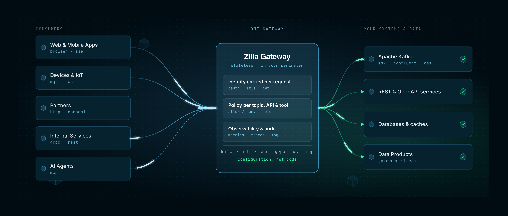
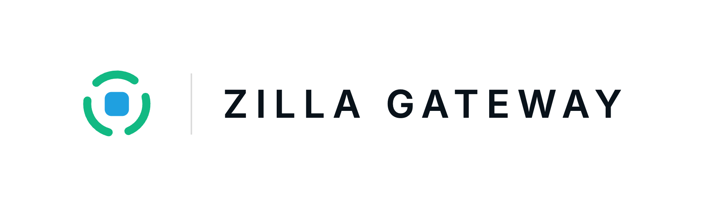
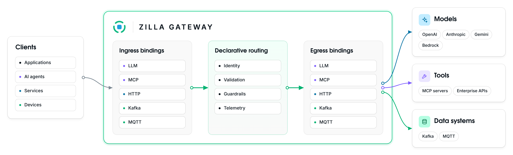

<div id="top"></div>

<div align="center">
  
  <!--  --> 
  
  <picture>
    <!-- Source for dark mode -->
    <source media="(prefers-color-scheme: dark)" srcset="./assets/zilla-gateway-lockup-dark.png">
    <source media="(prefers-color-scheme: light)" srcset="./assets/zilla-gateway-lockup-light.png">
    <!-- Fallback image for light mode and other clients -->
    
  </picture> 
  
</div>


<div align="center"> 
  
  <!--[![Build Status][build-status-image]][build-status]-->
  [![Latest Release][release-latest-image]][release-latest]
  [![Slack Community][community-image]][community-join]
  [![Artifact HUB][artifact-hub-shield]][artifact-hub]
  
</div>

<div align="center">
  <a href="https://docs.aklivity.io/latest/">Docs</a> &bull;
  <a href="https://docs.aklivity.io/latest/ai-gateway/get-started/">Quickstart</a> &bull;
  <a href="/examples">Examples</a> &bull;
  <a href="https://github.com/aklivity/zilla-demos">Demos</a> &bull;
  <a href="https://www.aklivity.io/blog">Blog</a>  
</div>

<br></br>
> 
> Before moving on, please consider giving us a GitHub star ⭐️. Thank you!
> 

* * * * *

**Zilla is a streaming-native, multi-protocol gateway for AI, APIs, and real-time data.**

Connect applications and agents to LLM providers, enterprise tools, and event streams through one high-performance gateway. Zilla handles protocol translation, routing, security, and observability at the edge, without requiring separate proxy services or custom integration code for supported backends.

Use existing AI SDKs to access models across providers. Give agents one governed MCP endpoint for enterprise tools and data. Expose Kafka streams through application-friendly protocols. With **Zilla Plus**, securely connect native Kafka clients across networks and tenants through the same gateway architecture.

Zilla composes protocol-native bindings in a lightweight, stateless runtime, configured declaratively in `zilla.yaml`. LLM access, MCP tool connectivity, and event streaming are different uses of the same gateway architecture, not three separately deployed gateways.

## What You Can Build

### Connect applications to LLMs

Use OpenAI, Anthropic, or Google Gemini SDKs with Zilla as the gateway endpoint. Route requests by model, translate supported chat and tool-call workflows between provider APIs, stream responses, apply configurable prompt and response guardrails, and export token and latency metrics. Configure fallback when a model deployment cannot be reached. **Zilla Plus adds Amazon Bedrock**, including access from existing SDKs.

**Try it:** [Cross-provider LLM demo](https://github.com/aklivity/zilla-demos/tree/main/llm.gateway) | [LLM documentation](https://docs.aklivity.io/latest/ai-gateway/llm-gateway/)

### Give agents governed access to enterprise tools and data

Aggregate existing MCP servers, turn HTTP/OpenAPI services into tools, and expose Kafka capabilities directly over MCP without building wrapper services for those backends. Present a single namespaced MCP endpoint, authorize what each caller can discover and invoke, and keep the default tool list compact with on-demand discovery.

**Try it:** [MCP example](./examples/mcp.proxy/) | [MCP documentation](https://docs.aklivity.io/latest/ai-gateway/mcp-gateway/)

### Bring real-time data to applications, services, and devices

Expose Kafka-backed REST APIs and live streams to HTTP, SSE, WebSocket, gRPC, and MQTT clients. Apply protocol-aware authentication, authorization, schema validation, and data policies at the gateway instead of building and operating custom bridges.

**Try it:** [Kafka REST example](./examples/http.kafka.crud/) | [Kafka Gateway documentation](https://docs.aklivity.io/latest/kafka-gateway/)

### Secure and virtualize native Kafka access (Zilla Plus)

**Zilla Plus adds native Kafka-to-Kafka proxying** through the [`kafka-proxy` binding](https://docs.aklivity.io/latest/reference/2.x/config/bindings/kafka-proxy/). Existing Kafka producers and consumers connect using the Kafka wire protocol through a gateway bootstrap address, while Zilla Plus proxies traffic to the backing brokers. No application-level protocol bridge is needed.

- **[Virtual Kafka clusters](https://docs.aklivity.io/latest/kafka-gateway/use-cases/virtual-kafka-clusters/):** Give teams or tenants their own Kafka cluster endpoints, topic and consumer-group namespaces, ACLs, and quotas on a shared physical cluster.
- **[Dynamic topic aliases](https://docs.aklivity.io/latest/kafka-gateway/use-cases/dynamic-topic-aliases/):** Let clients use the same external topic name while mapping requests to identity-specific internal topics, without per-client routing entries.
- **[Secure public access](https://docs.aklivity.io/latest/kafka-gateway/use-cases/secure-public-access/):** Connect external Kafka clients through custom DNS and TLS, with IAM, SASL/SCRAM, or mTLS authentication instead of exposing brokers directly.
- **[Secure private access](https://docs.aklivity.io/latest/kafka-gateway/use-cases/secure-private-access/):** Connect across VPCs and AWS accounts, including Amazon MSK Serverless, through private endpoints and a unified domain without making the brokers public.

These capabilities run on Zilla's stateless, horizontally scalable gateway architecture. **Explore:** [Kafka Gateway use cases](https://docs.aklivity.io/latest/kafka-gateway/use-cases/) | [Zilla editions](https://docs.aklivity.io/latest/reference/editions/)

## Get Started

The examples below use Docker Compose. Run them in separate sessions: several examples share local ports.

### 1. Try the LLM gateway

**Prerequisites:** Docker Compose and API keys for the model providers you want to call.

```bash
git clone --depth 1 https://github.com/aklivity/zilla-demos.git
cd zilla-demos/llm.gateway
cp .env.example .env
```

Edit `.env` to add your provider keys:

```dotenv
ZILLA_VERSION=2.6.0
OPENAI_API_KEY=<your-openai-api-key>
ANTHROPIC_API_KEY=<your-anthropic-api-key>
GEMINI_API_KEY=<your-gemini-api-key>
```

For Apple silicon or another ARM64 host, also uncomment `TEI_VERSION=cpu-arm64-1.9` in `.env`. Keep `.env` out of version control.

```bash
docker compose up --build --wait
```

Open the [demo app at localhost:7860](http://localhost:7860). For example, select the **OpenAI SDK**, choose a `claude-*` model, and send a prompt. Zilla routes it to Anthropic, translates the request and response, and returns the result in the OpenAI format your SDK expects.

Or try the same cross-provider call from the command line:

```bash
docker compose run --rm -e SDK=openai -e MODEL=claude-haiku-4-5 llm-client
```

Explore streaming replies, tool calls, guardrail rejections, model fallback, and comparisons across providers. Open the [Grafana dashboard](http://localhost:3000) for token usage, request counts, latency, and time to first token, or inspect raw metrics:

```bash
curl -s http://localhost:7190/metrics | grep '^llm_'
```

The demo uses **bring-your-own-key** credentials: callers send a valid key for the provider handling the request. Translating an API does not make a key from one provider valid at another. Gateway-managed credentials can also be configured. Some guardrail checks in this demo use accompanying Presidio and embedding services.

For the full walkthrough, including Gemini and the Zilla Plus / Bedrock extension, see the [LLM demo README](https://github.com/aklivity/zilla-demos/blob/main/llm.gateway/README.md).

### 2. Try the MCP gateway

From a separate terminal, after stopping the previous demo (`docker compose down`), run:

```bash
git clone --depth 1 --branch 2.6.0 https://github.com/aklivity/zilla.git
cd zilla/examples/mcp.proxy
docker compose up --wait
```

The gateway listens at `http://localhost:7114/mcp` over MCP Streamable HTTP. This example combines MCP servers, HTTP/OpenAPI-backed tools, and Kafka-backed tools. Its protected toolkits require JWT scopes; use the instructions in the [example README](./examples/mcp.proxy/README.md) to obtain a token and connect Claude Code or MCP Inspector.

### 3. Expose Kafka through a REST API

After stopping the MCP example (`docker compose down`), from the cloned `zilla` repository:

```bash
cd ../http.kafka.crud
docker compose up --wait

curl -X POST http://localhost:7114/items \
  -H 'Content-Type: application/json' \
  -d '{"greeting":"Hello from Zilla"}'

curl http://localhost:7114/items
```

This example backs REST create/read/update/delete operations with a Kafka topic. Browse the records in [Kafka UI](http://localhost:8080/ui/clusters/local/all-topics).

[Browse all examples](./examples/) | [Read the documentation](https://docs.aklivity.io/latest/)

## Why Zilla?

Most systems do not speak the protocols of the services they need. AI applications call model APIs; agents use MCP; business services expose HTTP and gRPC; real-time data lives in Kafka and MQTT. Building bridges between them typically means more adapters, proxies, credentials, and operational overhead.

Zilla addresses that fragmentation at the gateway:

- **One runtime for many protocols.** Compose LLM, MCP, HTTP, SSE, WebSocket, gRPC, Kafka, and MQTT connectivity in a single deployment, with shared configuration and telemetry infrastructure.
- **Native translation instead of application-side wrappers.** Connect supported models, APIs, tools, and event streams through protocol-aware bindings, rather than maintaining custom middleware for every integration.
- **Governance at the boundary.** Enforce caller identity, route and model access, MCP tool visibility and invocation, schema rules, and configured LLM guardrails independently of client implementations. Controls remain specific to each protocol and policy configuration.
- **Streaming-native performance.** Preserve backpressure and avoid unnecessary buffering, copies, and allocations along the data path, including streaming LLM responses and event-driven traffic.
- **Simple deployment and operations.** Run a lightweight, stateless data plane in Docker or Kubernetes. External stores are optional for features that need shared state across replicas.

## How It Works

Zilla connects protocol-aware **bindings** into a route. A binding terminates or originates a protocol; routing and configured guards determine where traffic goes and what is permitted. LLMs, MCP tools, and event streams use the same streaming engine and operational model.



Under the hood, code-generated flyweights access encoded buffers without unnecessary object creation. Connections stay assigned to a worker to reduce contention, and bindings exchange back-pressured stream frames through the runtime. Stateless processing enables horizontal scaling; shared stores can be configured where distributed features require them.

[How Zilla Works](https://www.aklivity.io/post/how-zilla-works) | [Configuration reference](https://docs.aklivity.io/latest/reference/2.x/)

## Capabilities

| Area | What Zilla enables |
| :--- | :--- |
| **Protocol connectivity** | HTTP, SSE, WebSocket, gRPC, MQTT, Kafka, MCP, and supported LLM APIs in one composable runtime |
| **LLM providers and APIs** | OpenAI Chat Completions, Anthropic Messages, and Google Gemini in Zilla Community; Amazon Bedrock in Zilla Plus |
| **LLM routing and interoperability** | Model-based routing, supported request/response and tool-call translation, streaming, and connectivity-based fallback |
| **LLM governance** | Caller authentication, model-aware authorization, configurable prompt/response guardrails, and provider credential handling |
| **MCP connectivity** | Aggregate MCP servers; expose HTTP/OpenAPI and Kafka-backed capabilities as tools without custom wrappers for supported backends |
| **MCP governance and discovery** | Identity-aware tool listing and invocation; namespaced toolkits; eager and on-demand discovery |
| **API and event integration** | Expose Kafka through REST and streaming protocols; connect services and devices across supported protocols |
| **Native Kafka-to-Kafka proxying (Zilla Plus)** | Transparent Kafka client access, virtual Kafka clusters, identity-driven topic aliases, and secure public/private connectivity |
| **Data validation** | Protocol-appropriate schema validation and supported JSON, Avro, and Protobuf transformations |
| **Observability** | Gateway and protocol metrics, MCP interaction metrics, and provider-reported LLM token usage and latency; Prometheus/OTLP export |
| **Deployment** | Docker and Kubernetes/Helm; stateless data-plane scaling, with optional external shared stores where needed |

**LLM compatibility notes:** Translation covers supported chat, streaming, and tool workflows, not every provider-specific parameter or API feature. Configured fallback is for deployments that cannot be reached; it does **not** trigger on provider responses such as HTTP `429` or `5xx`. See [dialect translation](https://docs.aklivity.io/latest/ai-gateway/llm-gateway/dialect-translation/) and [fallback](https://docs.aklivity.io/latest/ai-gateway/llm-gateway/fallback/).

## Explore the Documentation

- **Models and LLMs:** [LLM overview](https://docs.aklivity.io/latest/ai-gateway/llm-gateway/) · [Model routing](https://docs.aklivity.io/latest/ai-gateway/llm-gateway/model-routing/) · [Guardrails](https://docs.aklivity.io/latest/ai-gateway/guardrails/llm/) · [2.6.0 cross-provider demo](https://github.com/aklivity/zilla-demos/tree/main/llm.gateway)
- **Agents and tools:** [MCP overview](https://docs.aklivity.io/latest/ai-gateway/mcp-gateway/) · [MCP quickstart](https://docs.aklivity.io/latest/ai-gateway/get-started/) · [Tool discovery](https://docs.aklivity.io/latest/ai-gateway/mcp-gateway/tool-discovery/)
- **Real-time data:** [Kafka Gateway](https://docs.aklivity.io/latest/kafka-gateway/) · [Examples](./examples/)
- **Native Kafka connectivity (Zilla Plus):** [Use cases](https://docs.aklivity.io/latest/kafka-gateway/use-cases/) · [Virtual clusters](https://docs.aklivity.io/latest/kafka-gateway/use-cases/virtual-kafka-clusters/) · [Dynamic topic aliases](https://docs.aklivity.io/latest/kafka-gateway/use-cases/dynamic-topic-aliases/) · [Secure public access](https://docs.aklivity.io/latest/kafka-gateway/use-cases/secure-public-access/) · [Secure private access](https://docs.aklivity.io/latest/kafka-gateway/use-cases/secure-private-access/)
- **Observability:** [Monitoring](https://docs.aklivity.io/latest/ai-gateway/monitoring-observability/)

## Editions

**Zilla Community** includes multi-protocol event connectivity, MCP capabilities, and core LLM access to OpenAI, Anthropic, and Gemini, including routing, translation, guardrails, and metrics.

**Zilla Plus** includes everything in Community and adds native Kafka-to-Kafka proxying, virtual Kafka clusters, dynamic topic aliases, secure public and private Kafka access, Amazon Bedrock integration, advanced OAuth capabilities, distributed stores, and commercial support. See the [Kafka Gateway use cases](https://docs.aklivity.io/latest/kafka-gateway/use-cases/) and [editions](https://docs.aklivity.io/latest/reference/editions/) for details.

## Install with Your Own Configuration

For a guided first experience, use the [LLM quickstart](#1-try-the-llm-gateway) above. The commands below run Zilla with a configuration you supply; they do not generate a working `zilla.yaml` for you.

### Docker

```bash
docker pull ghcr.io/aklivity/zilla:2.6.0

docker run --rm \
  -p 7114:7114 \
  -v "$(pwd)/zilla.yaml:/etc/zilla/zilla.yaml:ro" \
  ghcr.io/aklivity/zilla:2.6.0 \
  start -v
```

Adjust published ports to match the listeners in your configuration.

### Kubernetes / Helm

```bash
helm install zilla oci://ghcr.io/aklivity/charts/zilla \
  --namespace zilla \
  --create-namespace \
  --wait \
  --values values.yaml \
  --set-file 'zilla\.yaml=zilla.yaml'
```

Choose chart settings and gateway image version appropriate for your deployment. See the [deployment documentation](https://docs.aklivity.io/latest/).

## Resources

- [📖 Documentation](https://docs.aklivity.io/latest)  
- [✨ AI Gateway](https://docs.aklivity.io/latest/ai-gateway/)  
- [⚡ Quickstart](https://docs.aklivity.io/latest/ai-gateway/get-started/)  
- [🧪 Examples](https://github.com/aklivity/zilla/tree/develop/examples)
- [🎬 Demos](https://github.com/aklivity/zilla-demos)  
- [🗺️ Roadmap](https://github.com/orgs/aklivity/projects/4/views/1)  
- [💬 Discord Server](https://discord.gg/RbUeKPsxq)  
- [💬 Community Slack](https://www.aklivity.io/slack)  
- [🐛 GitHub Issues](https://github.com/aklivity/zilla/issues)  
- [🦎 Contributing](https://github.com/aklivity/zilla/blob/develop/.github/CONTRIBUTING.md)


## License

Zilla is made available under the [Aklivity Community License](LICENSE-AklivityCommunity).

The license allows you to deploy, run, and modify Zilla for your own workloads, including production and cloud deployments. It does not permit offering Zilla as a standalone commercial Zilla-as-a-service product. Review the license text for the full terms.

<!-- Badge links -->
[community-image]: https://img.shields.io/badge/slack-@aklivitycommunity-blue.svg?logo=slack
[community-join]: https://www.aklivity.io/slack
[artifact-hub-shield]: https://img.shields.io/endpoint?url=https://artifacthub.io/badge/repository/zilla
[artifact-hub]: https://artifacthub.io/packages/helm/zilla/zilla
[release-latest-image]: https://img.shields.io/github/v/release/aklivity/zilla?label=release&sort=semver
[release-latest]: https://github.com/aklivity/zilla/releases

<p align="right">(<a href="#top">Back to top</a>)</p>
